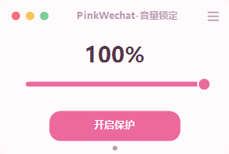

# PinkWechat 音量锁定

Windows 小工具：当微信录音使系统主音量变化时，尝试在录音期间维持原有音量。无需修改或注入微信。

## 使用

下载仓库中的 `PinkWechat.exe` 后运行，点击“开启保护”；拖动滑条可调整系统主音量。关闭窗口会收起到托盘，双击托盘图标恢复窗口，右键托盘图标可退出。

首次启动默认开启当前用户的开机自启。通过右上角菜单可关闭；关闭选择会保存。开机启动时程序隐藏到托盘，检测到微信进程后自动开启保护。移动程序后重新启动一次以更新自启路径。

## 构建

Windows 上需要 .NET Framework 4.x 及对应的 C# 编译器，运行 `build.bat`，输出 `dist/PinkWechat.exe`。没有额外第三方运行库。程序未签名时 Windows 可能提示未知发布者。

## 工作方式与限制

- 检测常见微信进程及默认录音设备上的活动音频会话；不读取、存储或上传麦克风音频。
- 记录默认播放设备的主音量，在检测到录音期间和结束后约 2 秒内纠正变化。纠正是事后反应，可能有短暂音量跳动；外部音量调整在保护期也会被纠正，但可用本程序滑条设置新的目标值。
- 非默认录音设备、微信进程或录音机制发生变化时可能无法识别，不保证支持所有微信版本。禁用保护或退出托盘程序即可停止。
- 使用当前用户的 `HKCU\Software\Microsoft\Windows\CurrentVersion\Run` 项管理自启；设置保存在 `HKCU\Software\PinkWechatVolume`，诊断日志保存在 `%LOCALAPPDATA%\PinkCatVolume\guard.log`。无网络功能。
- 此项目不是微信官方产品，与腾讯无关联。开机自启、不同设备和微信版本尚需更多实机测试。

## 致谢

音频会话检测思路参考 [WeChatAudioHelper](https://github.com/jiusimeng8-cmd/WeChatAudioHelper)，其许可声明见 [THIRD_PARTY_LICENSES.md](THIRD_PARTY_LICENSES.md)。

## 许可

MIT，见 [LICENSE](LICENSE)。

---

# PinkWechat Volume Lock

A small Windows utility that helps keep the system master volume stable when recording a WeChat voice message. It does not modify or inject into WeChat.

## Usage

Download `PinkWechat.exe` from the repository, run it, and select **开启保护** (Enable protection). Drag the slider to adjust the master volume. Closing the window hides it in the notification area; double-click its tray icon to show it, or right-click and choose **退出** (Exit) to quit.

Startup is enabled for the current user on first launch. Use the menu in the upper-right corner to disable it; your preference is remembered. When launched at sign-in, the app starts in the tray and automatically enables protection when it detects WeChat. After moving the executable, launch it again to update its startup path.

## Build

On Windows, install .NET Framework 4.x with its C# compiler, then run `build.bat`. The output is `dist/PinkWechat.exe`. No third-party runtime libraries are needed. The unsigned executable may trigger a Windows unknown-publisher warning.

## How it works and limitations

- Detects common WeChat process names and active audio capture sessions on the default input device. It does not read, record, or upload microphone audio.
- Remembers the default output device master volume and corrects changes during recording and for around two seconds afterward. Corrections are reactive, so a brief dip can occur. Other external changes are also corrected during protection; use the app slider to change the target.
- Non-default microphones or changes in WeChat process names or capture behavior may prevent detection. Compatibility with every version is not guaranteed. Disable protection or exit the tray app to stop it.
- The app uses the current-user Run registry key for startup, stores preferences under `HKCU\Software\PinkWechatVolume`, and writes diagnostics to `%LOCALAPPDATA%\PinkCatVolume\guard.log`. It has no networking functionality.
- This is an independent project and is not affiliated with Tencent or WeChat. Startup behavior, other devices, and WeChat versions need further real-world testing.

## Acknowledgments and license

The audio session detection approach was informed by [WeChatAudioHelper](https://github.com/jiusimeng8-cmd/WeChatAudioHelper). Its license is included in [THIRD_PARTY_LICENSES.md](THIRD_PARTY_LICENSES.md). This project is available under the [MIT License](LICENSE).

